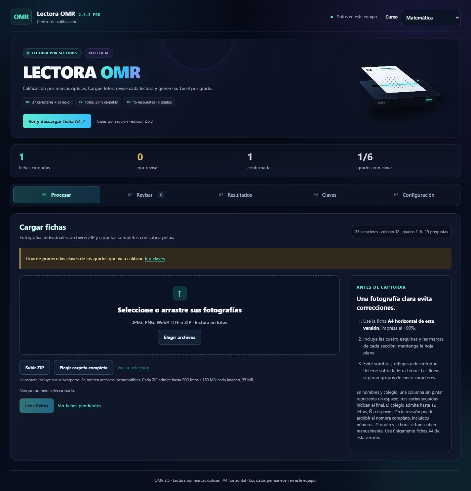
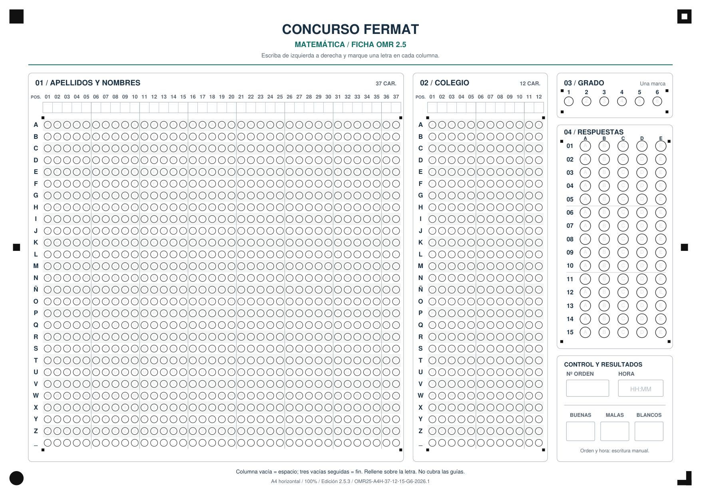

# OMR PRO FULL

Aplicación local de calificación para fichas **A4 horizontales**. Proyecto
Versión **2.5.3 Pro**, desarrollada por **Alberto Brayan**.

## Abrir

Haga doble clic en **IniciarOMR.bat**. Abre el navegador en
<http://127.0.0.1:5025>. Mantenga abierta la ventana de inicio mientras trabaja.
El entorno Python ya está preparado en este equipo. En otra instalación se
requiere Python 3.12 o superior; el primer inicio instala las dependencias.
Una vez instalado funciona sin internet. El servidor local usa Waitress.

### Acceso desde la red local

`app.py` e `IniciarOMR.bat` escuchan en todas las interfaces (`0.0.0.0:5025`).
En este equipo puede abrir `http://127.0.0.1:5025`. Desde otro equipo o celular
conectado a la misma red, use la dirección que aparece en la consola; actualmente
puede cambiar al reconectar la red; consulte la consola al iniciar.
Si Windows solicita permiso de firewall, permita Python en su red privada.
El equipo servidor debe permanecer encendido. Esta aplicación no tiene cuentas
de usuario: úsela sólo en una red de confianza y no publique el puerto en Internet.
Para restringir de nuevo el acceso a este equipo, defina `OMR_HOST=127.0.0.1`.

La interfaz 2.5.3 recupera el diseño Pro y mantiene una composición para PC
(ancho mínimo 1200 px). Las guías de sector inicializan el registro local;
los anillos verifican y afinan la cuadrícula. Las fichas 2.5 anteriores siguen
leyéndose por sus anillos aunque no tengan las nuevas marcas.

## Flujo de trabajo

1. En **Claves**, seleccione el curso y el grado y guarde sus 15 respuestas A-E.
   Hay seis claves independientes por curso: grados 1 a 6. No existen claves
   prellenadas ni calificaciones inventadas.
2. En **Ver y descargar ficha**, descargue la plantilla correspondiente.
   Puede configurar el título y cargar dos logos con proporción 30:9.
3. Imprima en **A4 horizontal, tamaño real / 100%, sin ajustar a página**.
   Use papel blanco y mantenga las guías de esquina, laterales y de sector libres.
   La edición 2.5.3 añade letras tenues, bandas de filas y separadores verticales
   cada cinco caracteres. La geometría de las burbujas se conserva.
4. Escriba el nombre en las casillas superiores y marque una burbuja por cada
   columna utilizada. Son **37 caracteres** para apellidos y nombres y **12**
   para colegio. Se admiten A-Z y Ñ. Una columna vacía representa un espacio;
   tres vacías consecutivas indican el final. También puede marcar `_` para un
   espacio explícito. Para colegios con números use una abreviatura
   alfabética acordada; el nombre completo se puede corregir al revisar.
5. Marque exactamente un **grado, 1 a 6**, y una alternativa por pregunta.
   Hay 15 preguntas A-E. El número de orden y la hora se escriben a mano.
6. En **Procesar**, seleccione fotos, ZIP o una carpeta completa (incluye
   subcarpetas). Puede combinar selecciones y consultar la cola antes de leer.
   Se omiten los archivos incompatibles; una foto dañada no detiene el resto.
   Los nombres iguales en subcarpetas conservan su ruta de origen. Cada imagen
   admite 35 MB. Cada ZIP admite 200 fotografías y 180 MB (400 MB descomprimidos).
   Las carpetas se envían fotografía a fotografía, sin límite global de 200.
   No envíe imágenes reducidas por mensajería ni capturas de pantalla.
7. En **Revisar**, compare la lectura con la foto, corrija cualquier duda y
   transcriba orden/hora si desea incluirlos en los resultados. Las marcas
   de intensidad similar o lecturas tenues sin un relleno dominante requieren revisión.
   Puede confirmar individualmente o confirmar las lecturas claras tras
   revisarlas; las dudosas y dobles no se confirman en bloque.
8. En **Resultados**, descargue el Excel o el PDF de fichas calificadas.
   Sólo se exportan registros confirmados del curso seleccionado.

Al terminar cada carga, **Procesar** muestra directamente las fichas leídas:
imagen ampliable, nombre, colegio, grado, las 15 respuestas, puntaje provisional
y avisos. En lotes puede elegir una ficha de la lista y entrar a corregirla.

El lector distingue blancos (`-`) y dobles (`X`). Las dobles cuentan como malas;
una lectura incierta (`?`) debe corregirse antes de confirmar. Por defecto:
buena +10, mala -1 y blanco 0. Los valores pueden configurarse. Al cambiar una
clave o los puntajes, las fichas afectadas vuelven a revisión y deben
confirmarse de nuevo. Una foto cargada dos veces no duplica al alumno; dos fotos
distintas del mismo alumno sí necesitan una revisión humana de duplicados.

## Excel con el diseño de la editorial

El reporte utiliza la referencia `MATEMÁTICA SECUNDARIA 2DO.xlsx`, copiada de
forma independiente en `assets/report_template.xlsx`. El original de F: no se
modifica. Se conservan los logos, colores de puestos, anchos, bordes y formato
de impresión; el encabezado se adapta al curso y grado correspondiente.

El libro tiene seis hojas: **Grado 1** a **Grado 6**. Sus columnas son Puesto,
Apellidos y nombre, Colegio, Nº de orden, Buenas, Malas, Blanco, Puntaje y Hora.
La antigua columna Lugar se adapta a Nº de orden. Se conservan vacías las
hojas sin alumnos y se amplían las filas cuando se supera la capacidad original.
El archivo se descarga aparte; no sobrescribe la plantilla ni los datos reales.

## Mejora del lector 2.5.1: ajuste por zonas

La ficha impresa se conserva. Después de orientar la página completa, el lector
localiza los anillos de nombres, colegio, grado y respuestas por separado y
calcula un ajuste local robusto. Esto reduce errores por pequeñas deformaciones
o desplazamientos respecto de las coordenadas nominales. No utiliza la clave
ni nombres esperados para decidir qué burbuja está marcada.

En **Revisar**, el botón **Volver a leer por zonas** permite procesar de nuevo
la foto original sin duplicar el registro. La nueva lectura sustituye las
correcciones anteriores y vuelve a quedar pendiente de confirmación; conserva
orden y hora. Si la nueva lectura falla, se conserva el registro anterior.
La interfaz muestra cuántas cuadrículas se pudieron verificar y su ajuste máximo.

La versión **2.5.2** interpreta una o dos columnas vacías como espacios y deja
de leer el texto al encontrar tres vacías seguidas. Si hay varios rellenos,
elige el de mayor intensidad cuando tiene una ventaja clara sobre los demás;
conserva un aviso de las marcas más tenues descartadas. Los rellenos casi iguales
y las marcas tenues sin una elección dominante siguen requiriendo revisión.
No interpreta la intención del alumno ni copia el nombre manuscrito.

## Archivos y respaldo

- `data/`: base SQLite, configuración, fotos y resultados; respalde esta carpeta
  con el programa cerrado para conservar su trabajo.
- `samples/`: dos fichas A4 listas para imprimir.
- `omr-camera/`: código fuente de la cámara Android; compile el APK localmente.

El perfil `OMR25-A4H-37-12-15-G6-2026.1` comparte las mismas medidas entre PDF,
lectura y anotaciones. Usa un lienzo horizontal de 3508 × 2480 y cuatro marcas
de orientación más dos guías laterales para detectar desalineación local. Las
fichas A5/A6 anteriores se rechazan: no son intercambiables con esta versión.
La imagen debe conservar suficiente resolución, enfoque y luz. Los avisos de
calidad ayudan a revisar; no garantizan la corrección de una foto real.

## Android

El proyecto `omr-camera/` se adaptó a A4 horizontal: gire el teléfono para
capturar, incluya las cuatro esquinas y deje libres las guías laterales. El
selector del teléfono organiza carpetas por grado; **el grado oficial lo lee
el programa de la burbuja de la ficha**, no del nombre de la carpeta. La app
exporta fotos/ZIP y la calificación se realiza en Windows. El paquete
`com.lectoraomr.camera.v25` permite conservar instalada la app anterior.

El APK **debug de pruebas** se compila localmente y no se incluye en el repositorio. El encuadre y
la captura deben comprobarse en un teléfono físico; no es una publicación de
Play Store. Puede utilizar también la cámara normal del teléfono y cargar sus
fotos originales en la aplicación de Windows.

## Consola y desarrollo

```powershell
.\.venv\Scripts\python.exe -X utf8 iniciar_omr.py
.\.venv\Scripts\python.exe -X utf8 calificar_pack.py C:\Fotos --curso Matematica
.\.venv\Scripts\python.exe -m pip install -r requirements-dev.txt
.\.venv\Scripts\python.exe -X utf8 -m unittest discover -s tests -v
```

La carga por consola guarda fichas pendientes en la misma bandeja de revisión.
No confirma datos automáticamente.

Las pruebas cubren el PDF real rasterizado y marcado, seis grados, Ñ/espacios,
37 caracteres, giros, perspectiva, sombra, degradación JPEG, marcas desplazadas,
dobles y dudosas; además del flujo de revisión, la plantilla Excel y la
exportación completa por seis grados. Antes de imprimir en cantidad realice un
piloto con su impresora y teléfonos y compare manualmente cada lectura.

## Capturas





## Derechos de autor

**Copyright (c) 2026 Alberto Brayan. Todos los derechos reservados** para los
aportes originales de OMR PRO FULL. Consulte [LICENSE](LICENSE) y
[THIRD_PARTY_NOTICES.md](THIRD_PARTY_NOTICES.md). La base anteriormente publicada
bajo MIT conserva sus permisos. Un repositorio público permite visualizar y
hacer fork conforme a los términos de GitHub; no equivale a una licencia libre.

La publicación excluye la base de alumnos, fotografías reales, resultados,
configuración local, claves de firma y entornos de desarrollo. La plantilla
Excel incluida contiene cabeceras y valores de prueba, sin alumnos reales.

La prueba opcional sobre una fotografía real requiere definir
`OMR25_REAL_PHOTO` con una ruta local. Esa fotografía no se publica.
